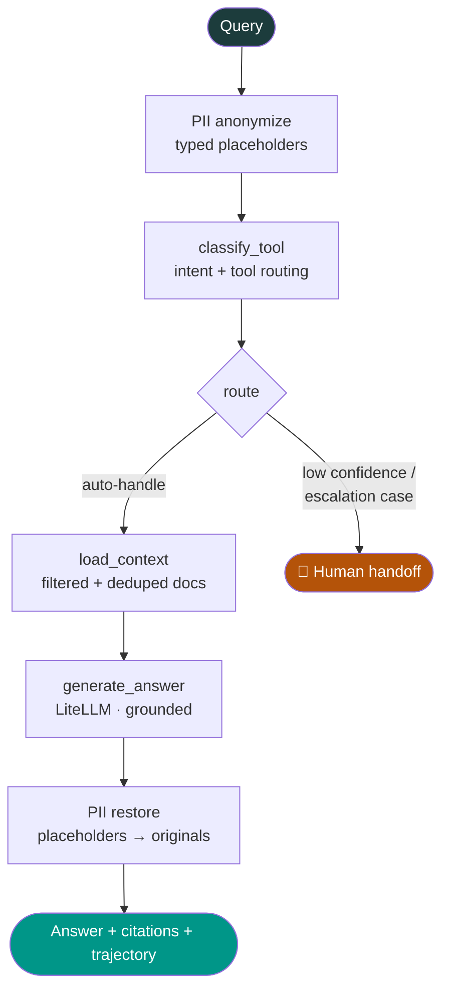

<div align="center">

<!-- ponytail: hero banner is a placeholder — drop a real 1280×320 PNG at docs/banner.png to replace this line -->


# 🤖 Novus Support Agent

### A LangGraph customer-support agent with tool use, guardrails, and confidence-based human escalation

*It reasons about which tools to call, plans multi-step, cites its sources — and hands off to a human when it isn't sure.*

<br/>

[](LICENSE)
[](https://www.python.org/)
[](https://langchain-ai.github.io/langgraph/)
[](https://fastapi.tiangolo.com/)
[](https://github.com/BerriAI/litellm)

<br/>

[**Quick Start**](#-quick-start) · [**How It Works**](#-how-it-works) · [**Evaluation**](#-evaluation) · [**Known Weaknesses**](#-known-weaknesses)

</div>

---

## 🧭 The Use Case

**Novus Bank** support agents field a high volume of customer queries — product questions, account issues, complaints. Some are answerable from policy; some genuinely need a human.

This project builds a **LangGraph agent** that receives a query, classifies intent, routes to the right tool, executes a multi-step plan, and returns a **grounded, cited answer** — or, when confidence is low or the case demands it, **escalates to a human** instead of guessing. It evolves from a naive Week 1 pipeline into a production agent by Week 4.

> [!NOTE]
> This is a **measurement-first** portfolio project. The scorecard below reports real numbers on a 42-query golden set — including the ones that need work.

---

## ✨ Features

| | Feature | What it does |
|---|---|---|
| 🧠 | **LangGraph agent** | Classifies intent, routes tools, plans multi-step (avg ~3 steps/query) |
| 🛠️ | **Tool use** | Intent-aware retrieval over product docs, deduplicated context |
| 🤝 | **Human escalation** | Confidence + rule-based routing hands off cases it shouldn't auto-answer |
| 🛡️ | **Input + output guardrails** | Safety gate on input; hallucination check on output |
| 🙈 | **PII anonymization** | anonymize → run pipeline → restore; the LLM never sees raw PII |
| 🔁 | **LLM fallback** | LiteLLM with a `gpt-3.5-turbo` fallback path |
| 📊 | **Agent-specific eval** | Classification / routing accuracy, escalation, faithfulness, correctness |
| 🌐 | **FastAPI + web UI** | `/query` returns answer **plus full trajectory**; `/health` for load balancers |

---

## 🚀 Quick Start

```bash
# 1. Install dependencies
pip install -r requirements.txt

# 2. Configure — add your API key(s)
cp .env.example .env

# 3. Ask the agent a question
python scripts/support_pipeline.py --query "What is the minimum balance for Novus Plus?"

# 4. Run the built-in test queries
python scripts/support_pipeline.py --test        # 9 functional queries
python scripts/support_pipeline.py --pii-test     # 4 PII-containing queries
```

<details>
<summary><b>▶ Run the FastAPI server + web UI</b></summary>

```bash
uvicorn api:app --host 0.0.0.0 --port 8080
```

```bash
curl localhost:8080/health

curl -X POST localhost:8080/query \
     -H 'Content-Type: application/json' \
     -d '{"query": "What is the minimum balance for Novus Plus?"}'
```

The `/query` response includes the agent's **full trajectory** (steps taken, tools called), not just the final answer. Open `http://localhost:8080/` for the UI.

</details>

---

## 🧩 How It Works



The agent runs the anonymizer around the whole pipeline, so the LLM sees only placeholder-substituted text and never the customer's raw PII.

---

## 📊 Evaluation

Scored on a **42-query golden set** (32 answerable + 10 should-escalate):

```bash
python scripts/eval_harness.py --save-baseline
```

<div align="center">

### Scorecard

| Metric | Score | |
|---|---|---|
| **Routing accuracy** | `96.9%` | Did it pick the right tool? |
| **Correct-handle rate** | `100%` | Of cases it should auto-answer, did it? |
| **Faithfulness** | `4.22 / 5.0` *(84.4%)* | Answer grounded in context? |
| **Correctness** | `4.28 / 5.0` *(85.6%)* | Answer factually right? |
| **Classification accuracy** | `75%` | Intent classified correctly? |
| **Refusal / escalation pass** | `4.0 / 5.0` *(80%)* | Declined/escalated when it should? |

*32 answerable + 10 escalation cases. Avg ~3 agent steps per answerable query.*

</div>

> [!WARNING]
> **Honest weak spots:** the **missed-escalation rate is 87.5%** — the agent auto-answers most cases it *should* have handed to a human. Classification accuracy (75%) is also the weakest link. Both are the primary follow-up targets. *(Numbers vary by model version; these are the current baseline figures.)*

---

## 🐛 Known Weaknesses

Surfaced by the eval, tracked for follow-up — not hidden:

1. **Missed escalations (87.5%)** — the routing threshold is too permissive; the agent over-handles cases that need a human. Highest-priority fix.
2. **Classification accuracy (75%)** — intent misclassification cascades into wrong tool routing on the harder queries.
3. **Single-pass retrieval** — no re-query, so multi-document questions can come back partial.

---

## ⚙️ Environment Variables

Copy `.env.example` to `.env` and fill in the required keys (LLM provider key required; optional observability keys). See `.env.example` for the full list.

---

## 📁 Repository Structure

```
.
├── scripts/
│   ├── support_pipeline.py     # Public entry point: handle_query()
│   ├── agent.py                # LangGraph agent definition
│   ├── query_classifier.py     # Intent + tool classification
│   ├── retrieval.py            # Intent-aware, deduplicated retrieval
│   ├── input_guardrail.py      # Input safety gate
│   ├── output_guardrail.py     # Post-generation hallucination check
│   ├── pii_anonymizer.py       # PII anonymize/restore
│   ├── llm_fallback.py         # LiteLLM fallback path
│   ├── eval_harness.py         # Agent eval harness
│   ├── golden_dataset.json     # 42 evaluation queries
│   └── baseline_scores.json    # Saved baseline for regression checks
├── data/products/              # Product policy docs
├── api.py                      # FastAPI wrapper (/query, /health)
├── frontend/                   # Browser UI
└── requirements.txt
```

---

<div align="center">

*Built for AI Systems in Production — Week 1 naive pipeline → Week 4 production agent.*

</div>
